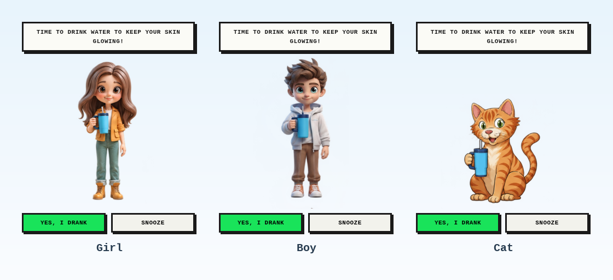
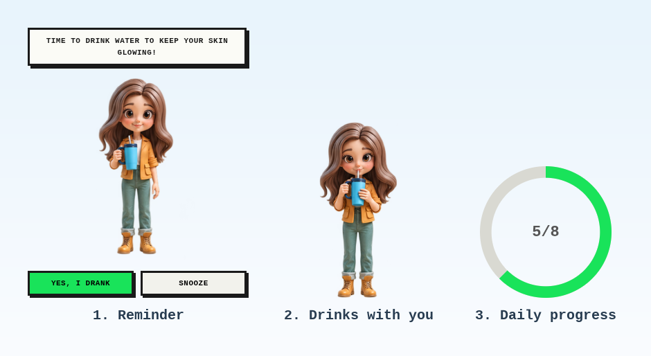
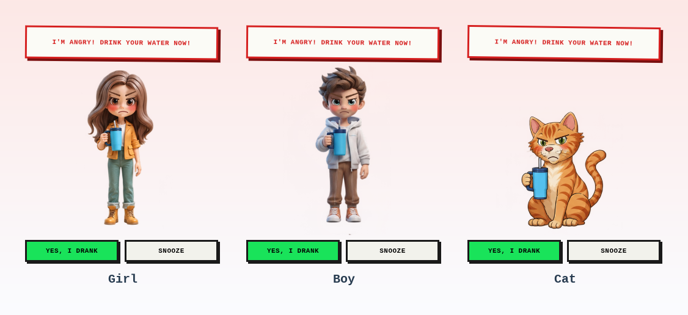
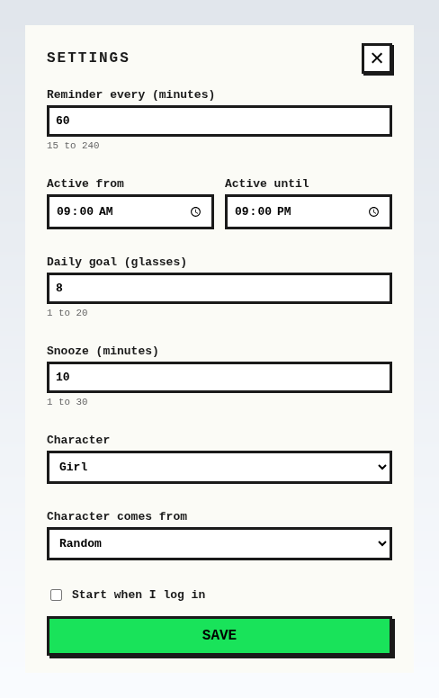

<div align="center">

# 💧 Water Reminder

**A tiny desktop companion that walks onto your screen and reminds you to drink water.**




</div>

---

## Overview

Water Reminder lives in your system tray. At the times you choose, a cartoon character walks into the bottom-right corner of your screen with a water tumbler and asks you to drink. Say **Yes** and it drinks along with you and updates your daily progress ring. Ignore it, and it gets impatient… then angry.

Everything stays on your computer: no account, no cloud, no analytics, no network calls.

## Features

- 🧍 **Animated characters**: Girl, Boy and Cat walk in from the edge you pick, wave hello and sip from their tumbler with you.
- ⏰ **Smart schedule**: remind every 15–240 minutes, only during your active hours.
- 🎯 **Daily goal**: a progress ring after each glass and confetti when you reach your goal. The count resets at midnight.
- 😴 **Snooze**: up to 3 snoozes per reminder (1–30 minutes).
- 😠 **Mood system**: ignore the reminder and the character gets impatient after 20 s and angry after 45 s, with a real angry face, stomping and a red speech box.
- ⚙️ **Simple settings**: interval, active hours, goal, snooze, character, entry side and start at login. Saving closes the window.
- 🔒 **Private by design**: settings and today's count are plain JSON in the app's local data folder.

## Screenshots

<table>
  <tr>
    <td align="center" colspan="2"><b>Drink along and track your progress</b><br></td>
  </tr>
  <tr>
    <td align="center"><b>Ignore it for 45 seconds…</b><br></td>
    <td align="center"><b>Settings</b><br></td>
  </tr>
</table>

## Getting started

**Requirements:** [Node.js](https://nodejs.org/) 18 or newer.

```sh
git clone https://github.com/Ayesha-Ramzan/water-reminder.git
cd water-reminder
npm install
npm run dev
```

> If `npm install` skipped Electron's binary download, run `node node_modules/electron/install.js`.

A water-drop icon appears in the system tray (macOS: menu bar; Windows: possibly under the `^` overflow arrow). Its menu has **Remind now**, **Pause / Resume**, **Settings** and **Quit**.

## How it works

| Step | What happens |
|---|---|
| 1 | At the next scheduled time, the character walks in and asks you to drink. |
| 2 | **YES, I DRANK**: it sips with you, adds a glass and shows today's progress (confetti at the goal). |
| 3 | **SNOOZE**: it leaves and comes back after the snooze time (max 3 times). |
| 4 | **No answer**: "HEY! I'M WAITING..." after 20 s, then an angry face after 45 s. Any button calms it down. |

## Project structure

```
src/
├── logic/       Pure, Electron-free rules: settings validation, schedule, snooze, daily reset
├── main/        Electron main process: tray, scheduler, windows, JSON store, character loader
├── preload/     The single secure bridge (window.water) between the UI and main
└── renderer/
    ├── popup/       Character popup (walk, wave, drink, moods, progress ring)
    └── settings/    Settings window
assets/characters/   One folder per character (PNG frames + character.json)
scripts/             Asset helpers (placeholder sprites, walk-video import, angry faces)
tests/               Jest tests
docs/images/         README screenshots
```

**Built with:** Electron, plain HTML/CSS/JavaScript (no framework) and Jest.
**Security:** context isolation is on, and the renderers only talk to the main process through a small preload API. The main process validates every setting again before saving it.

## Development

```sh
npm test               # run the Jest test suite
npm run gen:sprites    # regenerate the pixel placeholder sprites
python3 scripts/gen-angry.py           # rebuild angry.png faces (needs Pillow)
bash scripts/import-walk.sh <id> <video.mp4> [fps]   # green-screen video → walk frames (needs ffmpeg)
```

## Adding your own character

Create `assets/characters/<id>/` with:

- `idle.png`: transparent background; this alone is enough.
- Optional states: `greeting_1-4.png`, `drinking_1-8.png`, `angry.png`, and walk cycles `walk_side_N.png` / `walk_front_N.png` / `walk_back_N.png`. Walk frames must walk **in place**, because the app moves the character across the screen.
- Optional `character.json`: `{ "name": "Girl", "style": "smooth", "walkFps": 8, "walkFacing": "right" }`. `style` is `smooth` for 3D/illustrations or `pixel` for sharp pixel art.

Then add the id to `CHARACTERS` (and `RANDOM_POOL`) in `src/logic/settings.js`.

## Linux notes

The popup needs a compositing window manager for transparency. Linux cannot make the area around the character click-through, so the whole popup rectangle takes clicks. GNOME on Wayland needs an extension to show tray icons.

<details>
<summary><b>Hyprland window rule</b></summary>

Wayland apps cannot place their own windows, so add a rule for the popup's fixed title `Water Reminder Popup` (Lua config, Hyprland 0.56; put it after any rule that centres floating windows):

```lua
hl.window_rule({
    match            = { title = "^Water Reminder Popup$" },
    float            = true,
    pin              = true,
    center           = false,
    no_initial_focus = true,
    no_blur          = true,
    no_shadow        = true,
    no_dim           = true,
    border_size      = 0,
    rounding         = 0,
    opacity          = "1.0 override",
    move             = "(monitor_w-window_w-16) (monitor_h-window_h-16)",
})
```
</details>

## License

[MIT](LICENSE) © Ayesha Ramzan
